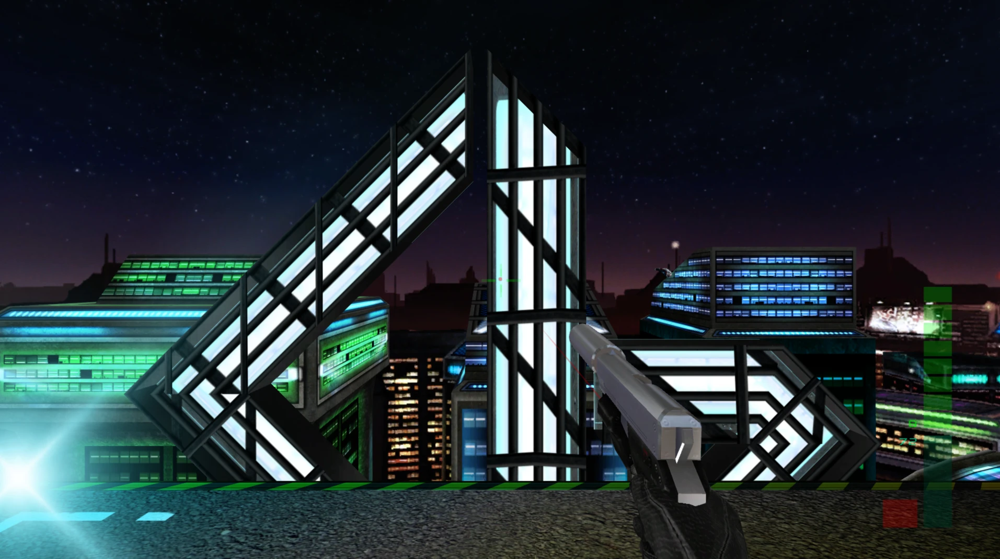
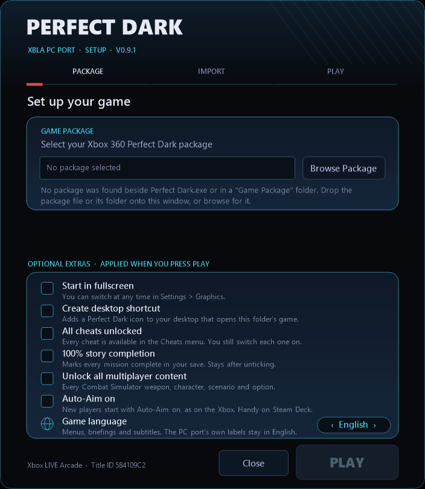
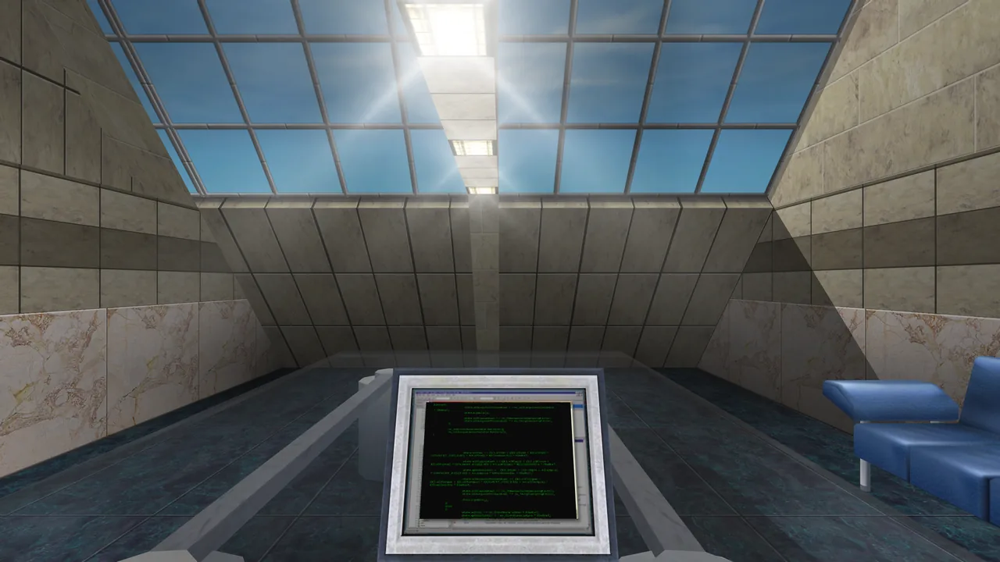
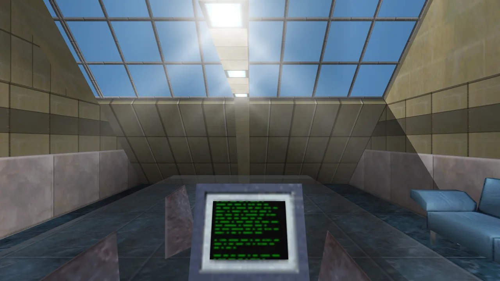
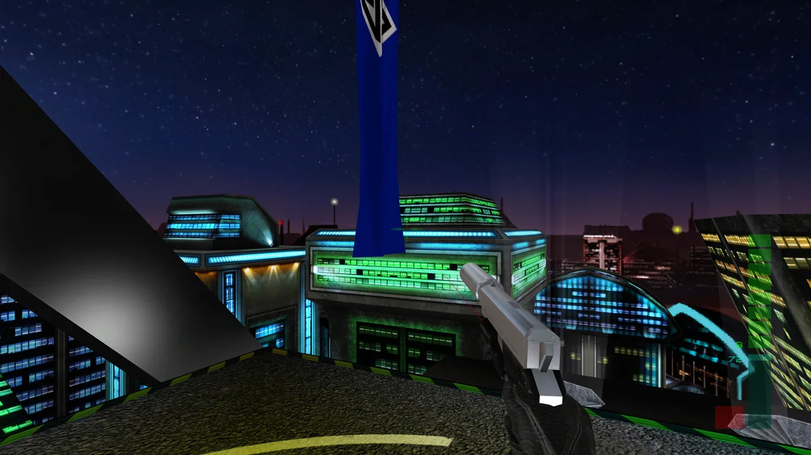
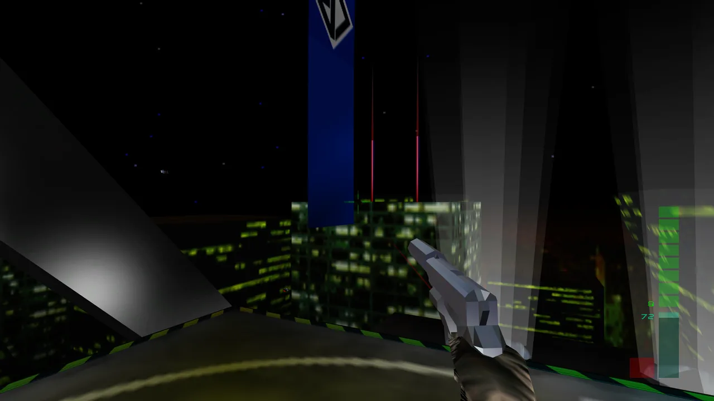
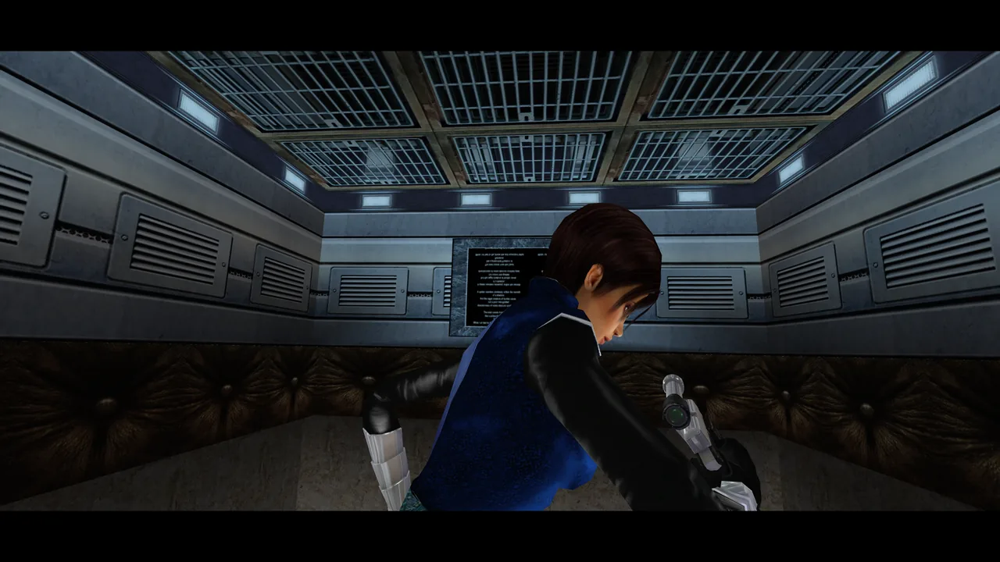
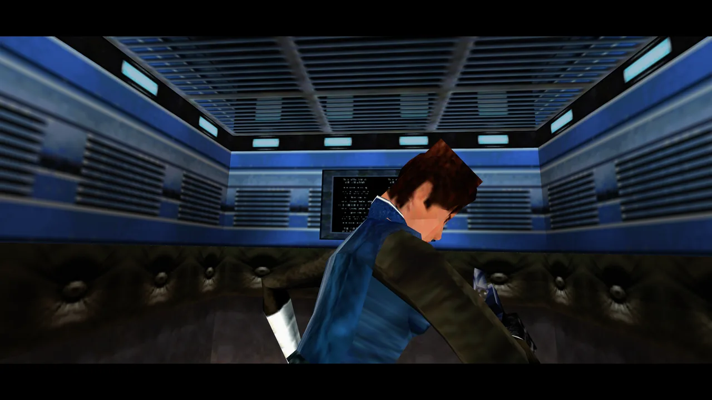
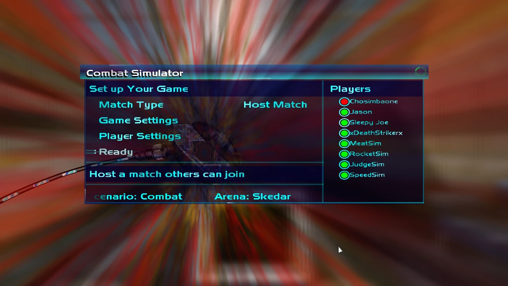
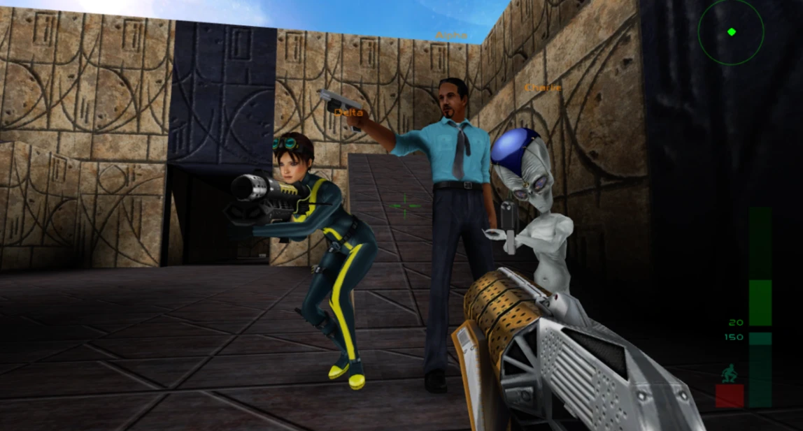

# Perfect Dark XBLA PC Recomp

A native Windows PC port of **Perfect Dark (2010)**, the Xbox 360 remaster by Rare and 4J Studios, built using [ReXGlue](https://github.com/rexglue/rexglue-sdk) static recompilation. Play at **up to 4K and 60 FPS**, with keyboard and mouse support, enhanced graphics, and LAN / Virtual LAN multiplayer. Import your own N64 ROM and you can **switch between the remastered and the original N64 graphics on the fly** with a single key. No emulator required.

**Free and open-source**.

Like the recomp and want to support future projects? You can
tip me on [Ko-fi](https://ko-fi.com/caiuscodes).

[](https://ko-fi.com/caiuscodes)



> **You must provide your own copy of Perfect Dark XBLA.** No copyrighted game files are distributed with this project. The launcher imports the required files from your Xbox 360 game package during first-time setup.

## Download & Installation

**[Download the latest release](https://github.com/CaiusCodes/Perfect-Dark-XBLA-PC-Recomp/releases)**

1. Download the latest ZIP and extract it to a folder of your choice.
2. Run `Perfect Dark.exe`.
3. Drag your Xbox 360 Perfect Dark package into the setup window, or select **Browse Package**.
4. Choose your preferred options, including fullscreen, language, optional unlocks and Auto-Aim.
5. Click **Play** once setup is complete.



After setup, simply run `Perfect Dark.exe` to play. Your original game package is no longer needed.

**To reopen setup:** Hold **Shift** while launching the game.

### System Requirements

- Windows 10 or 11 (64-bit)
- AVX2-compatible processor
- DirectX 12 or Vulkan-compatible graphics card
- Your own Perfect Dark XBLA package (Title ID `584109C2`)

Supported packages begin with `4287CC74` (original release) or `8292DB97` (re-release).

## Features

### Graphics & Performance

- **Native PC rendering** using Plume, with DirectX 12 (the default) or Vulkan (Settings → Graphics → Graphics API)
- **60 FPS** gameplay with improved frame pacing
- **Up to 4K resolution** with fullscreen and windowed modes
- **Render Scale:** 1x, 2x or 3x
- **AMD FSR 1** upscaling and adjustable sharpness
- **V-Sync**, Vivid Colours, Black Level and Camera Bob settings
- **F12 screenshots** and an optional FPS counter
- **Switch graphics on the fly** between two looks with **G** or D-pad Down: the remaster, the original N64 look (with your own N64 ROM) or an HD texture pack (see below)

Most graphics settings apply instantly; Render Scale and Graphics API restart the game.

### Controls & Quality of Life

- Full **keyboard and mouse** support, including raw mouse input, a Mouse Sensitivity slider and rebindable keys
- The mouse steers the CamSpy, the hoverbike and the Slayer's guided rocket
- On-screen tips show your keyboard keys when no controller is connected
- **Xbox controller** support, with **Stick Settings**: adjustable dead zones and response curves for each stick, for finer aiming
- **Advanced Control** options from Rare's 2010 Xbox 360 update: Legacy, Southpaw, Swap Triggers, Secondary Fire Reset, Lock Sight and Aim Sensitivity
- Explosions last as long as on the N64, as in Rare's 2010 update
- Native PC settings menus
- Optional Auto-Aim
- Skip cutscenes using mouse or controller
- Unlock all cheats, missions and multiplayer content during setup
- Five languages: English, French, German, Italian and Spanish
- Local achievements and leaderboards
- Portable installation with local saves and settings
- Built-in update checker

### Texture Packs & N64 Mode

Everything is under **Settings → Graphics → Texture Packs**:

- **Texture Pack 1 / Texture Pack 2**: each can be Remastered, N64 or any texture pack you have installed. Press **G** (or D-pad Down on a controller during play) to switch between the two on the fly, at any time, with no restart. **G** can be rebound under **Settings → Keyboard & Mouse → Switch Graphics**.
- **Import Texture Pack...**: one file picker for your own N64 Perfect Dark ROM (PAL or NTSC-U, any byte order), a texture pack's `.zip` or folder, or pictures named by texture number. Imports are checked for safety, and a pack is never installed twice.
- **N64 mode** draws the N64's textures, characters, guns, props, level rooms, skies, star fields and water from your ROM; the HUD, fonts and menus keep their current look. It only changes what you see, so in a network match each player can use either look.
- **HD texture packs** made for the N64 PC port load as they are, including the [Perfect Dark Plus HD](https://github.com/retro-foundry/Perfect-Dark-Plus-HD-Textures) packs (download one there and import its `.zip`). N64 emulator HD packs (Rice / GLideN64 hi-res naming) work too.
- **Texture Tools → Dump Game Textures...** saves the textures of the game, the N64 look or any installed pack as numbered pictures, for making packs. Pack makers can also tune a pack for this port with a `pd-pack.txt` file, reflection masks and `-xbla` pictures (see the README in the download).
- Both need Plume (the default renderer). No N64 game data is included: N64 mode only reads the ROM you import, and texture packs are their makers' work.

**One key press apart.** The same moments with Texture Pack 1 on Remastered and Texture Pack 2 on N64, switched with **G**:

| Remastered | N64 (from your own ROM) |
| --- | --- |
|  |  |
|  |  |
|  |  |

### Multiplayer

- **Up to 8 players** in Combat Simulator (up to 12 with Simulants)
- **2-player Co-Operative** and Counter-Operative modes
- LAN and Virtual LAN connections
- Compatible with Radmin VPN, ZeroTier, Tailscale and Hamachi
- Multiplayer music synchronised across connected players





## Keyboard & Mouse Controls

| Key | Action |
|---|---|
| W, A, S, D | Move |
| Mouse | Look / Aim |
| Left Click | Fire / Select |
| Right Click | Aim / Back |
| Middle Click | Zoom |
| E | Interact |
| R | Reload |
| Q (Hold) | Weapon menu |
| F | Secondary fire |
| Mouse Wheel | Switch weapons |
| Ctrl | Crouch |
| Tab | Objectives |
| G | Switch Graphics (between Texture Pack 1 and Texture Pack 2) |
| Esc | Pause / Back |

All key bindings can be customised under **Help & Options → Settings → Keyboard & Mouse**.

Xbox controllers use the original console controls.

## Updates

Check for new versions through **Help & Options → Settings → Check for Updates**.

If a newer version is available, choose **Update now**: the update is downloaded, verified against the checksum GitHub publishes and installed, without touching your imported game files, saves or settings. The game only goes online when you check.

Alternatively, download the latest ZIP from GitHub Releases and extract it over your existing installation.

For detailed changes and bug fixes, see the [release notes](https://github.com/CaiusCodes/Perfect-Dark-XBLA-PC-Recomp/releases).

## Known Limitations

- Windows only.
- Some multiplayer configurations.
- Vulkan has not been fully tested on AMD and Intel GPUs.
- N64 mode is tested with the PAL and NTSC-U (1.0 and 1.1) ROMs; the Japanese ROM is accepted but untested, and with it only the N64 textures are drawn.
- Windows SmartScreen may warn about the unsigned executable. Download only from the official release page.
- Windows Firewall may request permission for network multiplayer.
- Displays running at 144 or 165 Hz without variable refresh may exhibit uneven 60 FPS pacing. Use G-Sync / FreeSync or a 120 Hz refresh rate if available.

**Renderer compatibility:** If you encounter problems with Plume, the previous renderer can be enabled by adding `gpu_native = false` to `resources\userdata\perfect_dark.toml`.

## Reporting Issues

Found a bug? [Open a GitHub Issue](https://github.com/CaiusCodes/Perfect-Dark-XBLA-PC-Recomp/issues/new/choose).

Please include a description of the problem and your latest log from:

`resources\runtime\logs\`

For crashes, attach the corresponding `crash-*.dmp` file if available.

**For performance, stuttering or multiplayer issues:**

1. Open `resources\userdata\perfect_dark.toml`.
2. Set `diagnostics = true`.
3. Reproduce the issue and close the game.
4. Attach the latest log to your GitHub Issue.
5. Set diagnostics back to `false` afterwards.

## For Developers

Building from source. You need Git, CMake 3.25 or newer, Ninja, LLVM/Clang 18 or
newer (installed in `C:\Program Files\LLVM`), Python 3, Visual Studio 2022 or
newer with the C++ workload (for the Windows SDK and the Visual C++ runtime that
releases ship) and Windows PowerShell, plus your own Perfect Dark package.

ReXGlue is the `rexglue-sdk` submodule, pinned to upstream v0.9.0. This
project's changes to it are kept in `patches/rexglue.patch`, which CMake applies
automatically when it configures; the Plume renderer and XenosRecomp (the
`thirdparty` submodules) get theirs from `patches/plume.patch` and
`patches/xenosrecomp.patch` the same way. ReXGlue's dependencies are nested
deeply, so enable long paths when cloning, and keep the clone in a short folder
path:

```powershell
git -c core.longpaths=true clone --recurse-submodules --shallow-submodules https://github.com/CaiusCodes/Perfect-Dark-XBLA-PC-Recomp.git
cd Perfect-Dark-XBLA-PC-Recomp
```

Extract your package into `game/`, generate the recompiled code from your own
`default.xex`, then build the game:

```powershell
.\tools\Extract-STFS.ps1 -Path <your package> -OutputDir game
cmake --preset win-amd64-release
cmake --build --preset win-amd64-release --target perfect_dark_codegen
cmake --preset win-amd64-release
cmake --build --preset win-amd64-release
```

The `perfect_dark_codegen` step builds ReXGlue's code generator and translates
`game/default.xex` into C++ in `generated/`; the second configure picks that code
up. The generated code is derived from the game, so it is never committed (only
the SDK boilerplate `generated/rexglue.cmake` is). The port's changes to the
game's own code are codegen hooks: `perfect_dark_config.toml` lists them and
`src/perfect_dark_hooks.cpp` implements them. Never edit `generated/` by hand.

The game is built to `out/build/win-amd64-release/perfect_dark.exe`. To run it
from there, link your extracted package in as its `assets` folder:

```powershell
New-Item -ItemType Junction -Path "out\build\win-amd64-release\assets" -Target game
```

Developer features are off by default. In `perfect_dark.toml` (beside the exe
when run from the build folder):
- `diagnostics = true` writes the detailed log described above;
- `enable_rexglue_menus = true` brings back ReXGlue's F-key menus (settings and
  network panels);
- `pd_dev_hotkeys = true` enables the developer diagnostics hotkeys.

`.\tools\Make-Release.ps1` (or `Make Release.bat`) builds the release ZIP,
`out\release\Perfect-Dark-XBLA-PC-Recomp-v<version>.zip`. It holds one
`Perfect Dark` folder with the launcher (`Perfect Dark.exe`, built from
`packaging/launcher` by `packaging/Build-Launcher.ps1`), README, licences and
`resources\runtime` (the game and its DLLs), and never any game data. Before
zipping it audits the folder: forbidden file types, a byte comparison against
your extracted game, and a scan for personal paths. The version comes from the
`VERSION` file. Keep the ZIP's name when publishing a release: Check for
Updates looks for exactly that asset.

## Licence and Credits

This project's own code is released under The Unlicense (see
[LICENSE](LICENSE), which also lists what it does not cover). It is built on:

- [ReXGlue](https://github.com/rexglue/rexglue-sdk) by Tom Clay and contributors
  (BSD 3-Clause), which includes code derived from [Xenia](https://xenia.jp).
- [Plume](https://github.com/zolaware/plume) by renderbag and contributors (MIT), the rendering library the
  native renderer is built on, and
  [XenosRecomp](https://github.com/hedge-dev/XenosRecomp) (MIT), which translates
  the game's shaders on your PC with Microsoft's DirectX Shader Compiler.
- The STFS package reader (`packaging/launcher/stfs.cpp` and
  `tools/Extract-STFS.ps1`), derived from
  [Velocity](https://github.com/hetelek/Velocity) and licensed under the GPL-3.0.
  The launcher it is compiled into (`Perfect Dark.exe` in the release root) is
  therefore distributed under the GPL-3.0; the game itself is a separate program.
- The [Perfect Dark decompilation](https://github.com/n64decomp/perfect_dark)
  project, whose names and documentation of the N64 game helped find the way
  around this version's code (used as a reference; no code was copied).

ReXGlue, Plume, XenosRecomp and their third-party libraries keep their own
licences; see [packaging/licenses](packaging/licenses).

---

*Perfect Dark is the property of its respective rights holders. This is an independent fan project and is not affiliated with or endorsed by Microsoft, Rare or 4J Studios.*
