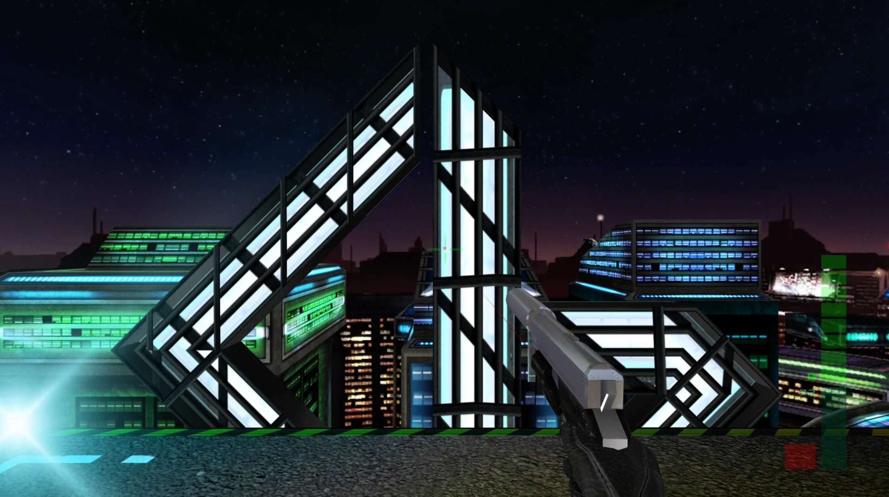
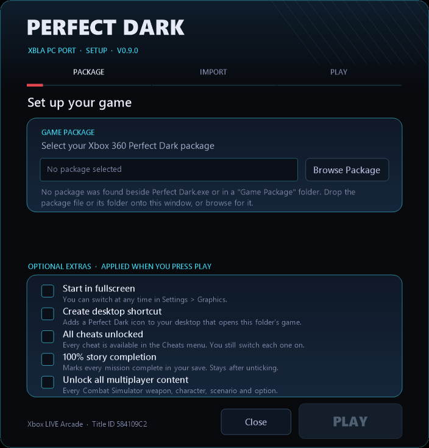
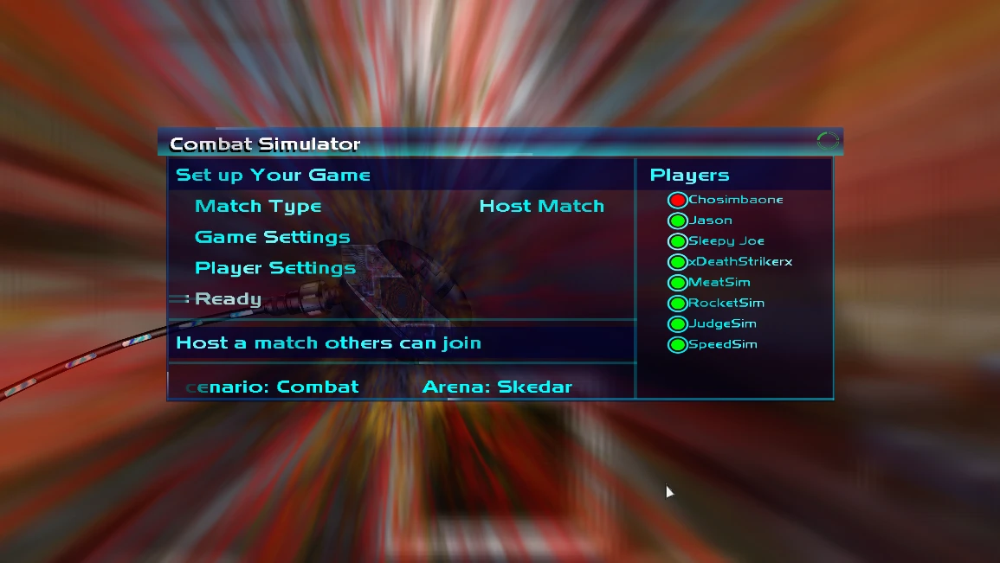
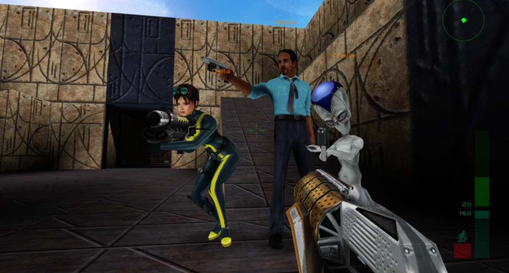

# Perfect Dark XBLA PC Recomp

A native Windows PC version of **Perfect Dark** from the 2010 Xbox 360 Xbox Live
Arcade remaster by Rare and 4J Studios. Created through static recompilation with
[ReXGlue](https://github.com/rexglue/rexglue-sdk). It runs 60 FPS at up to 4K
with keyboard and mouse or Xbox controller support and features a built in
LAN / Virtual LANmultiplayer for up to 8 players and 2 player co-op.

> **You need your own copy of Perfect Dark XBLA.** This project contains no
> original game program, graphics, sound, music or other game data. The first
> time you start it reads the Xbox 360 Perfect Dark package you provide
> (Title ID `584109C2`), checks that it is the supported version and imports the
> game data from it into the game's folder on your PC.

Like the recomp and want to support future projects? You can
tip me on [Ko-fi](https://ko-fi.com/caiuscodes).

[](https://ko-fi.com/caiuscodes)



## Requirements

- Windows 10 or 11, 64-bit
- A processor with AVX2 (Intel Haswell / 4th generation Core or AMD Ryzen and
  newer; most PCs from 2015 onwards)
- A graphics card with DirectX 12 or Vulkan support
- Your own Perfect Dark Xbox Live Arcade package (the Xbox 360 game file for
  Title ID `584109C2`)

## Install and play

1. Download the latest release ZIP from the
   [Releases](https://github.com/CaiusCodes/Perfect-Dark-XBLA-PC-Recomp/releases)
   page and extract the **Perfect Dark** folder somewhere you can write to (not
   Program Files).
2. Open **Perfect Dark.exe**. The first time, the setup window opens.
3. Drag your package file onto the window or click **Browse Package**.
4. Tick any optional extras: start in fullscreen, desktop shortcut, all cheats
   unlocked, 100% story completion, unlock all multiplayer content.
5. Click **Play** once it says READY TO PLAY.



After setup opening `Perfect Dark.exe` starts the game straight away; the
package is not needed again. Everything stays inside the extracted folder
(`resources\assets` for the imported game data, `resources\userdata` for saves
and settings), so it can be moved or backed up as a whole. To update, run a fresh install or
extract a new release over the folder: your imported data, saves and settings are kept.

The launcher only reads your package and never changes it. It downloads nothing,
needs no administrator rights and neither it nor the game contacts Xbox Live.

## Features

- **Native Windows PC build**: no emulator, runs as a normal Windows program
- **Up to 4K**: windowed or fullscreen at your screen's resolution, with
  **Render Scale** 1x, 2x or 3x the Xbox's 1280 × 720 (Settings → Graphics)
  and **Upscaling**: Off, Sharpen (AMD CAS) or FSR (AMD FSR 1)
- **Steady 60 FPS** (the game's own rate) with V-Sync, Direct3D 12 on
  NVIDIA and Vulkan on AMD and Intel graphics cards are picked automatically
- **Keyboard and mouse**: raw mouse look with rebindable keys and the mouse support in every menu
- **Xbox controller** support working alongside keyboard and mouse; button
  prompts hide themselves when no controller is connected
- **LAN and Direct Connect multiplayer** for up to 8 players with 2 player co-op over virtual
  LAN services such as Radmin VPN, ZeroTier, Tailscale and Hamachi
  
  
- **Local split-screen** for up to 4 players on one PC
- **Settings menus** in Help & Options: Keyboard & Mouse, Gamepad Controls,
  Graphics, Display Interface, Audio and Online
- **Leaderboards and achievements** kept on your PC
- Optional extras in setup: **all cheats unlocked**, **100% story completion**
  (every mission on every difficulty) and **all multiplayer content unlocked**
- **Portable**: one program to open, no installer; saves and settings stay in
  the game folder

| Mode | Players |
|---|---|
| Local split-screen on one PC | up to 4 |
| LAN / Direct Connect | up to 8 |
| Combat Simulator | up to 12 in a match, players and Simulants |
| Co-Operative / Counter-Operative | 2 |

### Controls

| Key / button | Action |
|---|---|
| W, A, S, D | Move |
| Mouse | Look and aim; points in menus |
| Left click | Fire; select in menus |
| Right click | Aim; back in menus |
| Middle click | Zoom |
| E | Use / activate; select in menus |
| R | Reload |
| Mouse wheel | Next / previous weapon; one row in menus |
| Q (hold) | Weapon menu: move the mouse towards an item, release |
| F | Secondary fire |
| Ctrl | Crouch |
| Tab | Objectives |
| Escape | Pause; back in menus |

Keys can be changed in Help & Options → Settings → Keyboard & Mouse. An Xbox
controller works as on the console.

### Fixes

- The game clock no longer runs 2% fast and network matches no longer run
  0.25% fast with a double step every few seconds.
- Light and sun flares no longer showing through walls and causing slow downs
- Rooms with their lights switched off are dark but visible again (they went
  completely black), with objects kept darker than the room.
- Hosting a match no longer crashes after about three minutes in the lobby.
- In game multiplayer Virtual LAN games now sync smoothly with other players.
- Game no longer keeps three CPU cores fully busy: about a third of one core
  standing still reducing load.
- Xbox LIVE leftovers removed: dead buttons, gamer cards, storage device prompts
  and messages that don't apply on PC.
- Auto-Aim starts off, since the mouse aims; switch it on in Control settings.
- No Xbox LIVE Arcade logo at start-up; the Carrington Institute walk-in no
  longer turns Joanna with the mouse before the menu appears.
- Other miscellaneous fixes.

## Known limitations

- Windows only for now.
- The game is not digitally signed, so Windows SmartScreen may warn the first
  time: choose *More info*, then *Run anyway*. Windows also asks for network
  access the first time you host or join a LAN or Direct Connect game; allow it
  on private and public networks (virtual LANs often count as public).
- Only the Perfect Dark Xbox Live Arcade package with Title ID `584109C2` and
  the exact game program this port was recompiled from is supported; setup
  refuses other builds.
- Not yet tested: matches eight players, local split-screen, Counter-Operative
  over the network and AMD graphics cards on real hardware.
- At 144 or 165 Hz without G-Sync / FreeSync, 60 frames a second cannot be
  shown evenly; turn on G-Sync / FreeSync or set the screen to 120 Hz.

## Reporting a problem

**When reporting an issue please attach your latest `resources\runtime\logs`.**
If the game crashed, the log ends with a `[crash]` line and 
a `crash-<date>-<time>.dmp` is written beside it: attach that too.

For anything more detailed, stutter, slowdowns, multiplayer lag or anything that
comes and goes, a more detailed log helps most:

1. Close the game and open `resources\userdata\perfect_dark.toml` in Notepad.
2. Set `diagnostics = true` (add the line if it is not there) and save.
3. Play until the problem has happened a few times then close the game.
4. Open an Issue and attach the newest log from `resources\runtime\logs`.
5. Set it back to `false` afterwards.

## For Developers

Building from source. You need Git, CMake 3.25 or newer, Ninja, LLVM/Clang 18 or
newer (installed in `C:\Program Files\LLVM`), Python 3, Visual Studio 2022 or
newer with the C++ workload (for the Windows SDK and the Visual C++ runtime that
releases ship) and Windows PowerShell, plus your own Perfect Dark package.

ReXGlue is the `rexglue-sdk` submodule, pinned to upstream v0.9.0. This
project's changes to it are kept in `patches/rexglue.patch`, which CMake applies
automatically when it configures. ReXGlue's dependencies are nested deeply, so
enable long paths when cloning, and keep the clone in a short folder path:

```powershell
git -c core.longpaths=true clone --recurse-submodules --shallow-submodules https://github.com/CaiusCodes/Perfect-Dark-XBLA-PC-Recomp.git
cd Perfect-Dark-XBLA-PC-Recomp
```

Extract your package into `game/`, generate the recompiled code from your own
`default.xex`, then build the game:

```powershell
.\tools\Extract-STFS.ps1 -Path <your package> -OutputDir game
cmake --preset win-amd64-release
cmake --build --preset win-amd64-release --target perfect_dark_codegen
cmake --preset win-amd64-release
cmake --build --preset win-amd64-release
```

The `perfect_dark_codegen` step builds ReXGlue's code generator and translates
`game/default.xex` into C++ in `generated/`; the second configure picks that code
up. The generated code is derived from the game, so it is never committed (only
the SDK boilerplate `generated/rexglue.cmake` is). The port's changes to the
game's own code are codegen hooks: `perfect_dark_config.toml` lists them and
`src/perfect_dark_hooks.cpp` implements them. Never edit `generated/` by hand.

The game is built to `out/build/win-amd64-release/perfect_dark.exe`. To run it
from there, link your extracted package in as its `assets` folder:

```powershell
New-Item -ItemType Junction -Path "out\build\win-amd64-release\assets" -Target game
```

Developer features are off by default. In `perfect_dark.toml` (beside the exe
when run from the build folder):
- `diagnostics = true` writes the detailed log described above;
- `enable_rexglue_menus = true` brings back ReXGlue's F-key menus (settings and
  network panels);
- `pd_dev_hotkeys = true` enables the developer diagnostics hotkeys.

`.\tools\Make-Release.ps1` (or `Make Release.bat`) builds the release ZIP,
`out\release\Perfect-Dark-XBLA-PC-Recomp-v<version>.zip`. It holds one
`Perfect Dark` folder with the launcher (`Perfect Dark.exe`, built from
`packaging/launcher` by `packaging/Build-Launcher.ps1`), README, licences and
`resources\runtime` (the game and its DLLs), and never any game data. Before
zipping it audits the folder: forbidden file types, a byte comparison against
your extracted game, and a scan for personal paths. The version comes from the
`VERSION` file.

## Licence and credits

This project's own code is released under The Unlicense (see
[LICENSE](LICENSE), which also lists what it does not cover). It is built on:

- [ReXGlue](https://github.com/rexglue/rexglue-sdk) by Tom Clay and contributors
  (BSD 3-Clause), which includes code derived from [Xenia](https://xenia.jp).
- The STFS package reader (`packaging/launcher/stfs.cpp` and
  `tools/Extract-STFS.ps1`), derived from
  [Velocity](https://github.com/hetelek/Velocity) and licensed under the GPL-3.0.
  The launcher it is compiled into (`Perfect Dark.exe` in the release root) is
  therefore distributed under the GPL-3.0; the game itself is a separate program.
- The [Perfect Dark decompilation](https://github.com/n64decomp/perfect_dark)
  project, whose names and documentation of the N64 game helped find the way
  around this version's code (used as a reference; no code was copied).

ReXGlue and its third-party libraries keep their own licences; see
[packaging/licenses](packaging/licenses).

Perfect Dark, Rare, Xbox and Xbox 360 are trademarks or property of their
respective owners. This is an unofficial fan project, not affiliated with or
endorsed by them.
